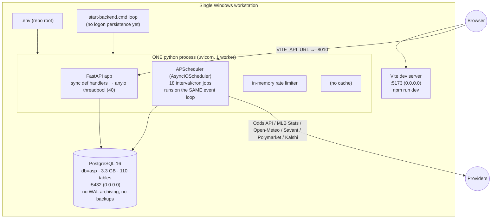
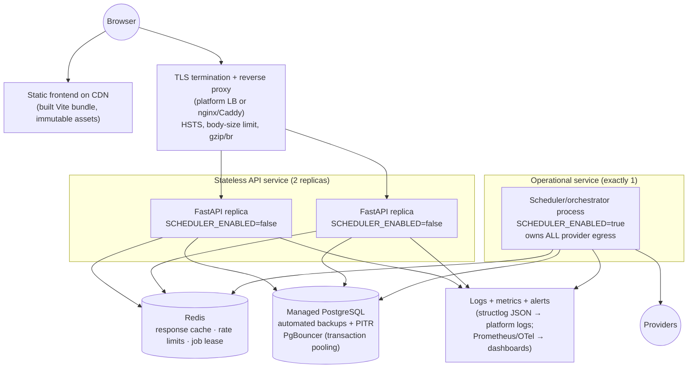

# AISP Production Architecture Plan — Fable 5.1 Audit

Audited commit `932f556` · Audit branch `claude/fable51-production-readiness-audit` · 2026-09-03

This plan is grounded in what was **OBSERVED** and **REPRODUCED** in the audit (see the master report and the scale report for the measurements). Everything under "target" is **RECOMMENDED**; nothing here has been deployed.

---

## 1. Current architecture (as actually running on 2026-09-03)

Properties that matter (all OBSERVED/REPRODUCED):

* **One process does everything.** API + scheduler + rate-limit state + provider quota gating share one event loop. Scheduler coroutines execute sync DB/CPU code inline ⇒ every HTTP request stalls for the job's duration (REPRODUCED: 3 ms endpoint → 28–53 s).
* **No read model / cache.** Each `/today` request rebuilds the board from ~500 queries plus several seconds of Python. (Repaired from ~9 s to ~2 s in this audit by fixing the dominant query; still far from a public-read budget.)
* **Scheduler is process-local.** `max_instances=1` and the "is running" flag are Python globals. A second replica = duplicate jobs and duplicate provider spend. Ledger rows are protected by DB uniqueness, so duplication is a cost/consistency problem, not a corruption one.
* **DB pool default** (5 + 10 overflow) is smaller than the request threadpool (40) ⇒ pool waits under modest concurrency.
* **No TLS, no reverse proxy, dev listeners on all interfaces, `APP_ENV=development`, `DEMO_MODE=true`.**
* **No backups, no PITR, no CI.**

## 2. Target launch architecture (Tier A: 5,000 registered / 250 concurrent)

Design goal: make the *public read path* cheap and cacheable, and make the *operational loop* independent of the API. No Kubernetes; a managed-container platform (Fly.io / Railway / Render / ECS Fargate / Azure Container Apps) plus managed PostgreSQL is sufficient for Tier A and Tier B.

### 2.1 Service split (the single most important change)

| Service | Command | Env | Replicas |
|---|---|---|---|
| `api` | `uvicorn app.main:app --workers 2` (or 1 worker × N replicas) | `SCHEDULER_ENABLED=false` | 2 (grow horizontally) |
| `scheduler` | new entrypoint `python -m app.jobs.runner` that builds the same `build_scheduler(settings)` and runs it in its own loop | `SCHEDULER_ENABLED=true` | **exactly 1** (enforce with a Redis/PG lease — see §5) |

The scheduler code already exists (`build_scheduler`); the only work is a standalone runner and a guard so an `api` replica refuses to start an embedded scheduler when `SCHEDULER_ENABLED=false`. This removes the event-loop head-of-line blocking entirely and makes `api` horizontally scalable.

### 2.2 Public read model + cache

* Serve `/today`, `/dashboard/today`, `/markets/board`, `/performance`, `/bankroll`, `/experiment/*`, `/prediction-markets/board` from a **cache keyed by (endpoint, operational date, evidence version)**.
* Evidence version = `max(forecasts.generated_at, odds_snapshots.observed_at, position_results.settled_at, job_runs.completed_at)` for the date — one cheap query — or an explicit `read_model_version` row bumped by the scheduler after each job. Cache TTL 30–60 s as a safety net; invalidate on version change.
* Emit `ETag` / `Last-Modified` from the version so browsers and the CDN revalidate for free; `Cache-Control: public, max-age=15, stale-while-revalidate=60` for public reads.
* **Never** cache anything derived from `Authorization` (today only `/auth/me`, `/admin/*`).
* Restrict `?date=` on public expensive endpoints to a bounded window (e.g. today ± 7 days) or serve historical dates only from the cache/materialised table.

Consistency rules (from the mandate): a stale cache must never show a false FINAL_QUALIFIED, a stale price, a stale bankroll, or a wrong settlement status. Each of those is written by the scheduler; bump the version at the end of `freeze-shadow-experiment`, `refresh-odds`, `settle-*`, `finalize-games` and the cache cannot lag those writes by more than the TTL.

### 2.3 Database

* Managed PostgreSQL with automated daily backups and PITR (WAL archiving) — currently **none**.
* PgBouncer (transaction pooling); app pool `pool_size=10, max_overflow=20, pool_timeout=5` per replica; `statement_timeout=15s` for the API role; `idle_in_transaction_session_timeout=30s`.
* Add `odds_snapshots (market_outcome_id, observed_at DESC)` composite index (serves the rewritten latest-per-book query; measure with `EXPLAIN ANALYZE` on the clone before/after) — see scale report §7.
* Split the application role: `asp_app` (DML on operational tables), `asp_ro` (read-only for API replicas once the read model exists), `asp_migrate` (DDL). Add DB triggers forbidding `UPDATE/DELETE` on `official_asp_positions`, `position_results`, `shadow_experiment_decisions`, `odds_snapshots` to make immutability defence-in-depth rather than ORM-only.
* Retention: `job_runs`, `audit_events`, `prediction_market_*_snapshots`, `odds_snapshots` grow unbounded; define partition-by-month or archival after 90 days for snapshot tables (they are append-only, so archival is safe).

### 2.4 Edge and platform hardening

* `APP_ENV=production` (the settings validator then enforces: unique 32+ char `SECRET_KEY`, non-default admin password, `DEMO_MODE=false`, https-only CORS, docs off, HSTS on).
* Bind API to loopback/private network only; proxy sets `X-Forwarded-For`; set `RATE_LIMIT_TRUST_FORWARDED_FOR=true` *only then*.
* Reverse proxy: `client_max_body_size 64k` for the API, request timeout 30 s, gzip/brotli.
* Frontend built once (`npm run build`), served by CDN; tighten nginx CSP `connect-src` to the API origin only.
* Container: non-root user, no migrations at container start (run `alembic upgrade head` as a release step), no `create-admin` at start.

### 2.5 Observability (minimum viable)

* Request-ID middleware; structlog already emits JSON with job IDs.
* `/readyz` (added in this audit) for LB health; `/healthz` for liveness.
* Metrics: request latency histogram per route, 5xx rate, DB pool in-use/wait, scheduler heartbeat age, last successful `daily-pipeline` age, forecast coverage (games with forecast / games), odds freshness age, provider quota remaining, job failure counts by job.
* Alerts (actionable): API down; DB unreachable; scheduler heartbeat > 10 min; no `daily-pipeline` success by 07:00 local; forecast coverage < 90% by 10:00 local; odds age > 30 min inside the pregame window; `freeze-shadow-experiment` failure; settlement lag > 3 h after final; quota < 10%; 5xx > 1%/5 min; p95 > 750 ms/5 min; pool wait > 100 ms; any job with 3 consecutive failures (would have caught the 286-failure alert bug in 30 minutes).

## 3. Growth architecture (Tier B: 25,000 registered / 1,000 concurrent)

Same shape, scaled:

* API replicas 4–6 behind the LB; Redis cache hit ratio target ≥ 95% on public reads.
* Move heavy per-request computation entirely out of the request path: a `read_model_today` table (JSON per operational date + sport) materialised by the scheduler after each relevant job; API reads one row.
* Asynchronous worker service (Celery/RQ/arq on Redis) for jobs that are long or provider-bound, with the scheduler only enqueuing; per-job idempotency keys stored in `job_runs` (`job_name`, `event_date`, `window_key`) with a unique constraint so a duplicate enqueue is rejected at the DB.
* Notification worker (email/push) separated from the operational loop.
* Read replica for `/research/history*` and analytics.
* Object storage for raw provider archives (`data/raw`) instead of local disk.

Triggers to move from Tier A to Tier B: sustained p95 > 500 ms on cached reads with cache hit ≥ 95%; DB CPU > 60% sustained; scheduler job duration approaching its interval; > 2 API replicas needed.

## 4. Strategic scale (Tier C bursts and beyond)

* CDN-cached public JSON with short TTL + stale-while-revalidate absorbs game-start/settlement bursts without touching the origin.
* Event-driven invalidation (scheduler publishes "version bumped" to Redis pub/sub; replicas drop local cache).
* Partitioned snapshot tables; dedicated ingestion cluster; per-sport worker pools once NFL/NBA are live.
* Only at this stage does an orchestrator like Kubernetes earn its complexity; before that, managed containers are simpler and cheaper.

## 5. Scheduler / worker separation and single-execution guarantee

Invariant required by the mandate: **one logical execution per (job, window)**, replica count independent.

1. Standalone `scheduler` service (1 replica) — removes the API coupling immediately.
2. Leader lease: on start, `SELECT pg_try_advisory_lock(<constant>)` (or Redis `SET NX PX`) — a second scheduler instance idles instead of double-firing. Cheap, DB-native, no new infrastructure.
3. Job-window idempotency: `job_runs` gets `window_key` (e.g. `daily-pipeline:2026-09-03`, `finalize-games:2026-09-03T15:30`) with `UNIQUE (job_name, window_key)`; `JobOrchestrator.run` inserts first and treats a unique violation as "already executed". This makes duplicate execution *rejected at the database*, satisfying the invariant even if the lease fails.
4. Startup reconciliation (added in this audit) + catch-up (added) become lease-aware (only the leader reconciles).
5. Missed-run detection: the alert "no `daily-pipeline` success by 07:00 local" plus the catch-up job closes the gap that produced the 2026-09-03 zero-slate day.

## 6. Caching semantics summary

| Data | Cache scope | TTL | Invalidation | Must never be stale for |
|---|---|---|---|---|
| Today / dashboard / market board | public, per date | 30 s | evidence version bump | final-qualified state, prices |
| Performance / bankroll / comparison | public | 60 s | settlement/finalization version | bankroll, settled counts |
| Sport registry / public config | public | 1 h | deploy | — |
| Game detail | public, per game | 30 s | per-game version | prices |
| `/auth/me`, `/admin/*` | **never cached** | — | — | — |

## 7. Backup / recovery

* Nightly logical backup (`pg_dump -Fc`) to object storage with 30-day retention **plus** WAL archiving for PITR (managed PG provides both).
* Quarterly restore drill into an isolated database; record RTO/RPO. Target RPO ≤ 15 min (PITR), RTO ≤ 1 h.
* Back up `.env`/secrets in the platform secret manager, never in git.
* Migrations: `alembic upgrade head` as a release step with the pre-release backup as the rollback point; downgrades are not trusted (several migrations are SQLite-incompatible and untested on PG rollback).

## 8. Cost drivers (explicit assumptions)

Assumptions: US region, managed containers, managed PostgreSQL, Redis small tier, Tier A traffic.

| Component | Tier A | Tier B | Driver |
|---|---|---|---|
| API containers | 2 × 1 vCPU / 1 GB | 4–6 × 1 vCPU / 2 GB | concurrency; CPU-bound Python |
| Scheduler container | 1 × 1 vCPU / 2 GB | 1 × 2 vCPU / 4 GB | job duration (feature rebuild, simulation) |
| PostgreSQL | 2 vCPU / 8 GB / 50 GB | 4 vCPU / 16 GB / 100 GB + replica | snapshot growth (~70 MB/wk odds + PM snapshots at current cadence) |
| Redis | 256 MB | 1 GB | cache + rate limits |
| CDN / egress | negligible | low | JSON bursts |
| Provider quota | Odds API plan | larger plan | pregame refresh cadence × games |

Cost is dominated by the database tier and the Odds API plan, not by compute.

## 9. Implementation sequence (dependency-ordered)

1. **Standalone scheduler runner + `SCHEDULER_ENABLED=false` on API** (removes head-of-line blocking; prerequisite for replicas).
2. **Public read cache with evidence-version invalidation** + bounded `?date=` (turns 2 s reads into ~5 ms).
3. **DB pool/timeouts config + composite index** (measured on clone).
4. **`APP_ENV=production` config, TLS proxy, loopback binds, container hardening, CI pipeline** (tests + pip/npm audit + build).
5. **Managed PostgreSQL with backups/PITR + restore drill.**
6. **Job-window idempotency + advisory-lock lease** (replica-safe scheduler).
7. **Alerts** from §2.5.
8. **Auth completion for public sign-up**: email verification, password reset, breached-password check, per-account lockout, Redis-backed rate limits.
9. **DB triggers / role split for immutability.**
10. Tier B items (read-model table, workers, read replica) when triggers in §3 fire.
