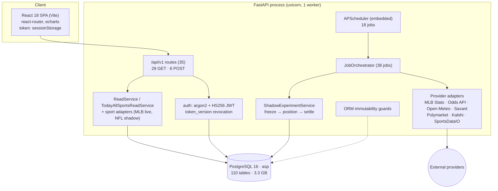
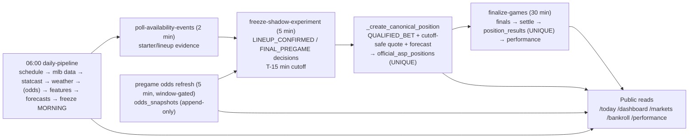

# AI Sports Predictor — Production-Readiness Audit (Fable 5.1)

Audited commit: `932f5564890b9f411ee6d7f323dea2800a8c2a78` — `fix: repair multi-sport daily hub audit defects` (branch `codex/multisport-platform-architecture`)
Main: `92f92dde5d5ec6b8d1d68e9d69284368dbd0525b` (unchanged)
Audit worktree/branch: `C:\Users\james\worktrees\aisp-fable51-production-audit` · `claude/fable51-production-readiness-audit`
Date: 2026-09-03 · Nothing pushed.

Companion deliverables: `AISP_FABLE51_THREAT_MODEL.md`, `AISP_FABLE51_SCALE_AND_CAPACITY_REPORT.md`, `AISP_FABLE51_PRODUCTION_ARCHITECTURE_PLAN.md`, `AISP_FABLE51_FINDINGS.json`.

Evidence labels: **OBSERVED** · **REPRODUCED** · **INFERRED** · **RECOMMENDED** · **NOT TESTED** · **BLOCKED**. No secret value appears in this document.

---

## 1. Executive verdict

**AISP_FABLE51_PRIVATE_ALPHA_READY.** The platform is a correct, honest, well-governed *single-tenant research instrument* that is not yet a *multi-user service*.

What is genuinely strong (OBSERVED/REPRODUCED): the virtual ledger is structurally sound (derived bankroll, DB-unique positions and settlements, cutoff-safe position creation, immutable policies), the public read boundary makes zero provider calls, NFL is provably research-only, authentication is modern (argon2, pinned HS256, DB-bound revocation, forged-role tests), and there is no real-wager path anywhere.

What blocks public exposure (REPRODUCED): the landing page cost ~9 s per request at *one* user and serialised to 62 s at eight; scheduler jobs run on the API event loop and froze a 3 ms endpoint for 28–53 s; the operational backend died twice this week with nothing to restart it; the day after one of those deaths had **no schedule and no forecasts** because the 06:00 pipeline has no catch-up; a prediction-market job failed 286 of 332 times unnoticed; there are **no database backups**; and the runtime is development mode with demo mode on, dev servers bound to all interfaces, no TLS, no CI.

Repairs made in this audit (all tested, zero regressions): the dominant read-path query (3–19× faster), the alerts crash, the missed-pipeline catch-up, abandoned-job reconciliation, a readiness probe, DB pool sizing, and a secrets-hygiene ignore rule. The remaining launch blockers are architectural (scheduler separation, read cache, hosting hardening, backups, auth completion) and are sequenced in the architecture plan.

Can it support thousands of users today? **No.** Measured ceiling ≈ 0.6 heavy page loads/second in one process (§13, §21).

## 2. Repository and runtime baseline (Lane 0)

| Item | Value (OBSERVED) |
|---|---|
| Primary checkout | `C:\Users\james\ai-sports-predictor`, branch `codex/multisport-platform-architecture`, HEAD `932f556`, clean except the preserved untracked `docs/MONTE_CARLO_SIMULATION_THEATER.md` |
| Other worktrees | `aisp-codex-repair` (clean, `932f556`), two `.claude/worktrees` with older dirty state (not the primary), two detached audit worktrees at `f6e92c8` |
| Collision check | No editor/builder writing source in the primary; only `.runtime/*.log` and `client/dist` changed in 3 days; Notepad had `SportsDataIO.txt` open at the repo root (untracked, not ignored) |
| Git locks | none |
| Runtime processes | Vite `node` PID 32840 `--host 0.0.0.0 --port 5173` (since 8/31 14:06); ASP uvicorn `:8010` PID 31016 (venv → anaconda python, started 9/3 11:46 by `start-backend.cmd`, no `--reload`, no `--workers`); Model Studio uvicorn `:8101`; unrelated `python -m src` on `:8000` (since 8/27); PostgreSQL 16.14 PID 5308 on `0.0.0.0:5432` |
| Authoritative DB | `postgresql+psycopg://asp_user:<redacted>@localhost:5432/asp` — 3,339 MB, 110 tables, `max_connections=100`, 9 active, 1 user (`admin@example.com`, ADMIN) |
| Env loaded | repo-root `.env` via `pydantic-settings` (`ASP_ROOT/.env`); non-secret values: `APP_ENV=development`, `DEMO_MODE=true`, `SCHEDULER_ENABLED=true`, `LIVE_SHADOW_ENABLED=true`, `NFL_SHADOW_ENABLED=true`, `PREDICTION_MARKET_OBSERVER_ENABLED=true`, `POLYMARKET_ENABLED=true`, `KALSHI_ENABLED=true`, `ODDS_POLLING_ENABLED=false`, `OFFICIAL_POSITIONS_ENABLED=false`, `ODDS_DAILY_REQUEST_BUDGET=40`, `CORS_ORIGINS=localhost:5173` |
| Migration head (source / live DB) | `20260831_0024` / `20260831_0024` — in sync; 24 revisions, 1 head, linear |
| Dependencies | `requirements.txt` ranges (no lockfile); `package-lock.json` present; Python 3.12.4 venv |
| Commands | backend `python -m uvicorn app.main:app --app-dir server --host 127.0.0.1 --port 8010`; frontend `npm run dev` (Vite, `--host 0.0.0.0`); tests `pytest` (server), `vitest run` (client) |
| CI / deploy | No CI. `docker-compose.yml` (local: hard-coded `<redacted>` password, migrations + `create-admin` at container start, API on `0.0.0.0:8000`, root user), `server/Dockerfile`, `client/Dockerfile` + `nginx.conf` (CSP/frame/nosniff headers). No IaC, no reverse-proxy config for production. |
| Scheduler | APScheduler `AsyncIOScheduler` inside the API `lifespan`; 18 jobs registered with the current flags |

Baseline test run **before any source change** (isolated in-memory SQLite fixtures; no live-DB mutation; provider egress monkeypatched in the tests that cover it):

| Suite | Result | Notes |
|---|---|---|
| Server `pytest tests/` | **1371 passed, 34 failed, 6 errors, 8 skipped** (1419) | All 40 non-passes confined to `test_gate2_migration`, `test_gate3*`, `test_migration_runtime`: `NotImplementedError: No support for ALTER of constraints in SQLite dialect` and fixture-artifact loaders. Pre-existing, unrelated to runtime. |
| Client `vitest run` | 116 passed, 6 failed (122) | All 6 are jsdom timing flakes under load: 4 still fail in isolation at the 5 s default, **29/29 pass with `--testTimeout=30000`**. |
| `tsc -p tsconfig.app.json --noEmit` | clean | |

## 3. Architecture diagram

## 4. Data-flow diagram (prospective MLB loop)

## 5. Trust-boundary diagram

See `AISP_FABLE51_THREAT_MODEL.md` §3 (rendered there in full). Boundaries: Browser⇄API (bearer JWT, CORS allowlist, no cookies), API⇄PostgreSQL (single app role, ORM-only immutability), API/scheduler⇄providers (constant hosts, timeouts, quota ledger), Process⇄host (`.env`, `0.0.0.0` binds).

## 6. Product-alignment matrix (Lane 1)

| Contract item | Status | Evidence |
|---|---|---|
| MLB has live operational evidence | **TRUE** | 15 games 9/2 with forecasts (`asp_mlb_ensemble 2.0.0-gate2-08cca634c81b`, 203 forecasts in 7 days); V2.1 positions created/settled |
| NFL research-shadow only, no funded positions | **TRUE** | registry `RESEARCH_SHADOW`, adapter forces `RESEARCH_ONLY`/`can_ever_fund=False`; no NFL experiment; tests `test_nfl_*` |
| NBA/WNBA/UFC planned, not operational, not deceptively live | **TRUE** | `PLANNED`, `navigable=False`, `navigation_href=None`; `/today?sport=NBA` → 400 |
| Runtime navigation consumes one registry | **TRUE at 932f556** | `useSportRegistry` fetches `/sports/registry`; client TS literals still hard-code sport codes (F51-025, P3) |
| One adapter failure does not crash Today | **TRUE** | `TodayAllSportsReadService` try/except → `UNAVAILABLE` section; tests |
| No raw-edge cross-sport ranking | **TRUE** | `cross_sport_ranking="NOT_APPLICABLE_PHASE_1"`; within-sport ranks only; test |
| Public reads call no provider; refresh spends no credits | **TRUE** | egress confined to job modules; `httpx` monkeypatch tests; Odds `apiKey` only in `data_sources/odds.py` |
| Market Pulse / prediction-market reads provider-free | **TRUE** | `test_public_reads_make_zero_provider_calls` |
| Honest states LIVE/EMPTY/UNAVAILABLE/DEGRADED/RESEARCH_SHADOW/DEMO | **MOSTLY TRUE** | `data_mode` provenance on every payload; UI refuses unprovenanced results; degraded reasons surfaced. **Gap:** a dead-scheduler day renders as an honest EMPTY slate (REPRODUCED 9/3) — repaired via catch-up, but the UI still has no "pipeline did not run" signal (RECOMMENDED alert). |
| Failed live pipeline never becomes demo | **TRUE** | `DEMO` only via `/demo/*` routes with explicit label; `_live_games_for_date` boundary |
| Model control = AISP_BASELINE; no silent activation of research models | **TRUE** | forecasts in last 7 days: only `asp_mlb_ensemble 2.0.0-gate2-…`; ModelVersion governance fields immutable; NFL M1 imported only into `shadow_*` tables |
| No real wagering; PM integrations read-only | **TRUE** | Polymarket/Kalshi clients are GET-only (no `.post(`, no order symbols; `test_no_trading_symbols_in_prediction_market_package`); no sportsbook write client exists |
| Market-observer data not a model feature | **TRUE** | no import of `prediction_markets` from `forecasting`/`features`/`modeling` |
| V1 / V2 (superseded) / V2.1 identities | **TRUE** | `shadow_experiments`: v1 `AISP_OPPORTUNITY_POLICY_V1` (2026-08-27, $1,000, MLB), v2 `…V2` (2026-09-01, superseded by constant `SUPERSEDED_POLICIES`, excluded from freeze/settle), v3 `…V2_1` (2026-09-01, $1,000); positions only under V2.1 (1 OPEN $2.50, 3 SETTLED $7.50, P/L +$5.08); 0 legacy positions |

Dead/misleading UI controls found: none material. `endpoints.sportsRegistry` was unused at `f6e92c8` and is now consumed. Two labels named "Final qualified" with different denominators were repaired in `932f556` ("OFFICIAL POSITIONS" vs "FINAL QUALIFIED DECISIONS").

DTO drift: `tsc` clean; runtime payloads match `TodayAllSportsReadModel`/`SportRegistryResponse` (verified against live `:8010` JSON). No endpoint returns 200 with a semantically failed payload (failures are 4xx/5xx or explicit `degraded`/`UNAVAILABLE`).

Timezone: operational date resolved via `local_today(America/New_York)`; DST tests exist; `job_runs.started_at` is tz-aware.

## 7. Security findings (Lane 2)

Summary: **0 P0**. No injection, no SSRF, no command execution, no secret in history, no trading path. Details and controls in the threat model.

| ID | Sev | Finding | Status |
|---|---|---|---|
| F51-012 | P2 | Dev listeners on `0.0.0.0` (Vite, PostgreSQL); runtime `APP_ENV=development`, `DEMO_MODE=true` ⇒ production validators bypassed | OPEN |
| F51-013 | P2 | Open registration; no email verification, reset, breached-password check, per-account lockout, MFA | OPEN |
| F51-011 | P2 | `SportsDataIO.txt` at repo root not ignored | **REPAIRED** (`d91be91`) |
| F51-014 | P2 | Immutability ORM-only | OPEN |
| F51-015 | P2 | No CI, no lockfile, root container, migrations at start, compose password | OPEN |
| F51-017 | P3 | No body-size limit | OPEN |
| F51-018 | P3 | Register 409 enumerates emails | OPEN |
| F51-019 | P3 | echarts moderate; pytest dev-only advisory | OPEN |

Scanner results: `npm audit` — 1 moderate (echarts <6.1.0, fix available), 0 high/critical. `pip-audit` (56 packages) — 1 advisory (pytest 8.4.2 PYSEC-2026-1845, UNIX `/tmp`, dev-only). Secret greps: `.env` never committed; no keys in tests or client bundle; log filter redacts `apiKey`.

Existing security tests already cover: tampered/`alg=none`/wrong-secret/expired/non-access tokens, forged admin claim, member→admin 403, unauthenticated admin 401, logout revocation, login rate limit, production CORS/docs/HSTS guards, password floor, admin bootstrap fail-closed.

## 8. Multi-user isolation findings (Lane 3)

**Key fact (OBSERVED): there are no user-owned resources exposed by the API.** `/bankroll`, positions, performance are the platform's single experiment ledger, public and read-only. Users exist for authentication and the ADMIN gate only. Tables for `user_virtual_bankrolls`, `community_posts`, `leaderboard_entries`, `private_leagues`, `analyst_ratings`, `entitlements` exist in the schema with no routes.

Therefore matrix items 13–17 (User A reading/mutating User B data, predictable IDs, client-supplied user id) are **N/A — not "proven"**: there is nothing to isolate yet. The audit's requirement for those features is recorded in the roadmap: object-level authorization checks and tests must ship *with* the first per-user route. Item 11–12 (member cannot reach admin; role from DB) are covered by existing tests. Item 3 (disabled user) is enforced by `get_current_user` (`status != ACTIVE` ⇒ 401) — OBSERVED, NOT separately tested.

## 9. Ledger-integrity findings (Lane 3/5)

| Invariant | Status | Evidence |
|---|---|---|
| Position created at most once per identity | **HOLDS** | `uq_official_position_experiment_outcome (shadow_experiment_id, market_outcome_id)` + unique `shadow_decision_id`; check-then-insert backed by the constraint ⇒ concurrent duplicate raises, never duplicates |
| Settled at most once | **HOLDS** | `uq_position_result (position_id)` + pre-check |
| Bankroll reconciles exactly to immutable entries | **HOLDS by construction** | `current_bankroll = starting_bankroll + Σ position_results.profit_loss`; no stored balance to drift |
| Retry cannot duplicate debit/credit | **HOLDS** | consequence of the above |
| Position immutable after creation | **HOLDS at ORM layer** | `_IMMUTABLE_POSITION_FIELDS`, delete guards; **not** at DB layer (F51-014) |
| Policies/decisions immutable | **HOLDS at ORM layer** | append-only types |
| No negative/impossible bankroll via concurrency | **HOLDS** | stake ≤ available (bankroll − open stake), caps applied; settlement runs in one transaction |
| Precision | **OK** | money `Numeric(12,2)`, odds `Float` |
| Cutoff safety | **HOLDS** | position requires FINAL_PREGAME decision with `recommended_at`, `quote_observed_at`, `forecast_cutoff`, `forecast.available_as_of/generated_at` all ≤ T-15 min; snapshot price/time must equal the decision's |
| Stale quote cannot qualify | **HOLDS** | above; `is_stale` on selections; tests in `test_shadow_experiment.py` |
| Push/void/cancel | **HOLDS** | `determine_result` PUSH on equality for spread/total; CANCELED ⇒ VOID; POSTPONED stays OPEN until FINAL |
| Moneyline tie | **gap** | equality ⇒ LOSS (F51-022, P3; MLB-safe) |

Partial-commit risk: `freeze()` commits once per run; an `IntegrityError` on one game rolls back the run's decisions and the next 5-minute run re-freezes — acceptable, visible in `job_runs`.

## 10. Scheduler / worker findings (Lane 6)

| # | Finding | Sev | Status |
|---|---|---|---|
| F51-002 | Jobs run on the API event loop ⇒ API freezes (REPRODUCED 28–53 s) | P1 | OPEN with plan |
| F51-003 | Missed 06:00 pipeline never caught up (REPRODUCED: 9/3 zero slate) | P1 | **REPAIRED** `885d321` |
| F51-005 | Backend unsupervised; died 9/2 16:20 and 21:12 | P1 | Mitigated (restart-loop script); logon persistence needs the owner |
| F51-006 | RUNNING rows orphaned forever (4 observed) | P2 | **REPAIRED** `885d321` |
| F51-009 | Process-local scheduler ownership / `max_instances` ⇒ replicas duplicate work | P2 | OPEN with plan |
| — | Provider failure visible? | OK | `refresh-odds` ConnectError ×36 and `poll-availability-events` ConnectError surfaced as FAILED runs; no fabrication |
| — | `refresh-prediction-market-snapshots` logs `errors: 122` yet `job_completed` | P3 | RECOMMENDED: treat error ratio as degraded |

Only one scheduling mechanism exists (in-process APScheduler); no OS scheduler, no worker service. Duplicate scheduler startup within one process is prevented (`max_instances=1`, `replace_existing`); across processes it is not.

## 11. Provider / egress findings (Lane 4)

All egress hosts are constants; timeouts on every client; quota ledger with reservation/terminal states and check constraints; pregame-window gating; daily budget (40). No user-supplied URL reaches a client. Prediction-market observer: read-only, GET-only, locally persisted, not a model input. Public endpoints cannot be used as a provider proxy (REPRODUCED by tests and probes). Response-size bounds: NOT enforced (P3). Circuit breaker: none (failures are per-run and visible).

## 12. Database findings (Lane 7)

* Migrations linear and in sync. Rollback: several migrations are SQLite-incompatible and downgrade paths are untested on PostgreSQL — treat as forward-only with pre-release backups.
* Constraints on ledger tables are correct (§9). Indexes on hot paths exist for `forecasts (game_id, track, status, version)`, `odds_snapshots (market_outcome_id)`, `(observed_at)`, `markets (game_id)`. **Missing (RECOMMENDED):** `odds_snapshots (market_outcome_id, observed_at DESC)` for the latest-per-book query — measured plan after the rewrite is 11 ms/game, 7,487 buffers, all index scans, so the gain is milliseconds; add only after re-measuring on a clone.
* Pool: repaired to configurable 10/20/10 s (`c8563af`).
* Growth: `odds_snapshots` 173k rows/66 MB, prediction-market snapshots ~159k rows/~200 MB in ~3 weeks; 2.9 GB of the 3.3 GB is historical/fd1 identity staging. No retention/partitioning (F51-023).
* Vacuum/analyze: autovacuum active on hot tables; `official_asp_positions` never analyzed (tiny).
* Backups/PITR: **none** (F51-010). `pg_stat_statements`: not installed. Superuser-only settings could not be read with the app role (expected).

## 13. Performance results (Lane 8)

Full detail in the scale report. Headline (REPRODUCED, read-only, live data):

| Path | Before (`:8010`, c=1) | After repair (`:8020`, c=1) | After, c=8 |
|---|---|---|---|
| `/today?date=2026-09-02` (15 games) | 8.2–9.3 s | **1.6 s** | 11.4 s p50 · 0.69 rps |
| `/markets/board?date=2026-09-02` | 7.2–8.4 s | **0.31 s** | 1.6 s p50 · 4.4 rps |
| `/games/{id}` | 0.66–0.80 s | 0.31 s | — |
| `/performance` | 4.4–4.9 s | 4.2 s (unchanged) | — |
| `/sports/registry` | 3 ms (but 28–53 s stalls under scheduler jobs) | 5 ms; 96 rps at c=32 | — |

Instrumented: `dashboard(15 games)` 509→494 queries, wall 7,320→2,354 ms, ORM instances 258,974→11,701.

Full Tier A/B/C load tests: **BLOCKED** — creating an isolated clone requires `CREATEDB`, which `asp_user` lacks; the audit refused to load-test the operational database beyond bounded read-only characterization.

## 14. Scalability assessment (Lane 9)

Process-local state: rate-limit counters, scheduler flags/instance, APScheduler memory jobstore, per-request memo (replica-safe by design). Decisions: rate limits → Redis; scheduler → standalone service + advisory-lock lease; job-window idempotency → `job_runs` unique key; caches → Redis/evidence-versioned. Provider quota is already DB-backed (replica-safe). Full target topology, tiers, triggers and cost drivers: architecture plan §2–§9. Kubernetes is not recommended before Tier C.

## 15. Reliability and disaster-recovery assessment (Lane 12)

* Backups: none. PITR: `archive_mode=off`. Restore: never performed ⇒ **RPO = ∞, RTO undefined**. Gate F fails.
* Recovery of secrets: `.env` only on this host.
* Restart behaviour: process restart ⇒ scheduler restarts (now with catch-up + reconciliation); JWTs survive restarts (stateless; `token_version` persisted).
* Graceful shutdown: `scheduler.shutdown(wait=False)` — in-flight jobs are abandoned (now made visible).

## 16. Observability assessment (Lane 11)

Present: structlog JSON with job ids, `job_runs` + `audit_events`, admin `/health/sources` (quota, freshness, recent runs), `apiKey` redaction, new `/readyz`. Absent: request ids, metrics, traces, dashboards, alerts, scheduler heartbeat export, coverage/freshness gauges. Actionable alert set defined in the architecture plan §2.5; the two highest-value alerts are "no `daily-pipeline` success by 07:00 local" and "≥3 consecutive failures of any job" (each would have caught a defect found in this audit).

Runbooks (RECOMMENDED, minimal):
1. *API unreachable* — check `/readyz`; if 000, restart via `C:\Users\james\AppData\Local\asp\start-backend.cmd`; verify `/readyz` 200; verify `job_runs` shows `daily-pipeline` catch-up if before noon.
2. *Missed slate* — `SELECT … job_runs WHERE job_name='daily-pipeline' AND started_at::date = today`; if absent after 07:00, trigger `POST /admin/jobs/daily-pipeline`; confirm forecasts count > 0 by 10:00.
3. *Odds stale in pregame window* — check `provider_request_ledger` quota; check `refresh-odds` FAILED rows; the board marks quotes `is_stale`; no manual price entry ever.

## 17. Deployment assessment (Lane 12)

Current deployment is a developer workstation: dev mode, demo mode on, Vite dev server, no TLS, no proxy, unsupervised process, DB on all interfaces. `APP_ENV=production` would today *refuse to start* on this `.env` (secret/admin-password/demo/CORS validators) — which is the correct behaviour and a useful gate. Compose/Dockerfile are local-only shapes. No release identity beyond `build_commit`. No rollback path beyond git. Recommended production configuration: architecture plan §2.4.

## 18. Privacy / responsible-product assessment (Lane 13)

User data held: email, display name, argon2 hash, role/status, `last_login_at`, token version, audit actor ids. No IP/device storage. No export/deletion endpoints, no privacy notice, no age gate, no responsible-gaming copy beyond "Research & simulation only — no real-money wagering" (which is accurate). Positions are virtual; no money is accepted; no sportsbook order is sent; performance pages show full ledgers (no cherry-picked windows OBSERVED). These items require qualified legal/compliance review before public launch; this audit is not legal advice (F51-024).

## 19. Repairs implemented (audit branch, not pushed)

| Commit | Scope | Tests |
|---|---|---|
| `0fa01ba` | `fix(prediction-markets)`: in-batch alert idempotency (F51-004) | `test_fable51_pm_alert_idempotency.py` — fails on original code with `UNIQUE constraint failed: prediction_market_alerts.idempotency_key`, passes after |
| `885d321` | `fix(scheduler)`: daily-pipeline catch-up (F51-003), abandoned-run reconciliation (F51-006), `/readyz` (F51-007) | `test_fable51_scheduler_reliability.py` — 14 tests |
| `c8563af` | `perf(read-service)`: SQL latest-per-book reduction + memo (F51-001); configurable DB pool (F51-008) | `test_fable51_latest_market_snapshots.py` — 4 (exact equivalence vs verbatim old reducer); `test_fable51_db_pool.py` — 3 |
| `d91be91` | `chore(security)`: ignore provider-key scratch files (F51-011) | — |
| (docs commit) | five deliverables | — |

Runtime verification (safe): isolated backend on `:8020` from the audit branch, scheduler and providers off, reads only — `/readyz` 200, latency table §13. The operational `:8010` process still runs commit `932f556`; nothing in the primary checkout was modified.

## 20. Remaining blockers (public launch)

1. Scheduler separation from the API process (F51-002) and replica-safe job execution (F51-009).
2. Evidence-versioned response cache / read model for public reads; bounded `?date=` (F51-001 residual).
3. Hosting hardening: `APP_ENV=production`, TLS proxy, loopback binds, non-root container, CI (F51-012, F51-015).
4. PostgreSQL backups + PITR + a proven restore (F51-010).
5. Auth completion for public sign-up (F51-013).
6. Alerting (F51-016).
7. Logon-persistent supervision for the local backend until the above exists (F51-005): either `shell:startup` entry or an *elevated* Scheduled Task (commands in the 2026-09-03 session notes; Task Scheduler refused registrations from a non-elevated session).

## 21. Capacity verdict

Current: ~0.6 rps for a 15-game Today, ~4 rps market board, ~100 rps static; safe concurrency ≈ 5–10 active users, and unreliable while scheduler jobs share the process. Tier A requires items 1–2 above; Tier B additionally the read-model table, workers and a read replica. See scale report §7.

## 22. Production-readiness gate matrix

| Gate | Verdict | Basis |
|---|---|---|
| A — Functional correctness | **PASS (private)** | flows work; DTOs align; honest states; lifecycle completes (V2.1 positions created and settled); failures visible in `job_runs` |
| B — Security | **PASS for invited alpha / FAIL for public** | auth resilient, roles server-enforced, secrets protected, no injection/abuse paths; but open registration lacks verification/reset, dev-mode exposure |
| C — Data & ledger integrity | **PASS** | immutable positions (ORM), idempotent settlement (DB unique), exact derived bankroll, correct identity; DB-level triggers recommended |
| D — Operational reliability | **FAIL** | one scheduler but embedded and loop-blocking; jobs idempotent; restart/catch-up now works; dependencies degrade honestly; no actionable observability |
| E — Scale | **FAIL** | measured evidence exists, ceiling known (~0.6 rps heavy), bottlenecks identified, pool stabilised, public reads provider-free; scale-out blockers documented, not repaired |
| F — Deployment & recovery | **FAIL** | production config explicit but not used; no backups; no restore; no release/rollback path; health/readiness gates now exist |

## 23. Prioritized remediation roadmap

**NOW — before any public beta** (each with gate)
1. Standalone scheduler process + `SCHEDULER_ENABLED=false` on API. *Effort:* 1 day. *Risk:* low. *Gate:* `/sports/registry` p99 < 50 ms while `freeze-shadow-experiment` runs.
2. Evidence-versioned cache for `/today`, `/dashboard/today`, `/markets/board`, `/performance`, `/bankroll`; bound `?date=` to ±7 days on those. *Effort:* 2–3 days. *Gate:* p95 < 300 ms at c=50 on an isolated clone; no stale FINAL_QUALIFIED/price/bankroll across a scheduler bump (test).
3. Backups + PITR + one restore drill. *Effort:* 1 day (managed PG) . *Gate:* documented RPO/RTO from a real restore.
4. Production config on a real host: TLS proxy, `APP_ENV=production`, loopback binds, CI running pytest/vitest/tsc/pip-audit/npm-audit. *Effort:* 2 days. *Gate:* `APP_ENV=production` process starts and serves `/readyz` 200 behind TLS.
5. Logon-persistent supervision of the current local runtime (owner action). *Gate:* backend survives a logoff/logon and a session teardown.

**NEXT — limited public beta**
6. Email verification, password reset, HIBP k-anonymity check, per-account lockout, Redis-backed limiter, ADMIN MFA. *Effort:* 3–5 days. *Gate:* tests 1–12 of the matrix green including account-level lockout.
7. Alerts: pipeline-missed, job-failure streak, odds-stale, settlement-lag, 5xx, p95, pool wait, quota. *Effort:* 2 days. *Gate:* a forced job failure pages within 15 minutes.
8. Job-window unique key + advisory-lock lease. *Effort:* 1 day. *Gate:* two schedulers started concurrently produce exactly one run per window (test).
9. DB triggers forbidding UPDATE/DELETE on ledger tables; role split. *Effort:* 1 day. *Gate:* raw `UPDATE official_asp_positions` fails as the app role.
10. Frontend retry/backoff + registry refetch; vitest timeout. *Effort:* 0.5 day.

**THEN — thousands of users**
11. Read-model table materialised by the scheduler; API replicas 2→4; PgBouncer; composite snapshot index measured on the clone; snapshot-table retention/partitioning. *Gate:* Tier B load test on the clone meets SLOs.
12. Async worker service for provider-bound jobs; read replica for research pages.
13. Object-level authorization framework and tests **before** the first per-user route (bankrolls, leagues, community).

**LATER — strategic scale**
14. CDN-cached public JSON with event-driven invalidation; per-sport worker pools when NFL/NBA go live; privacy/compliance program (deletion/export, age gating, jurisdictional review).

## 24. Exact test record

| Run | Command | Result |
|---|---|---|
| Baseline server (pre-change) | `pytest tests/ -q -p no:cacheprovider` (audit worktree, SQLite fixtures) | 1371 passed / 34 failed / 6 errors / 8 skipped (1419) |
| Baseline client | `vitest run` | 116 passed / 6 failed (122) — timing flakes; 29/29 pass at 30 s timeout |
| Typecheck | `tsc -p tsconfig.app.json --noEmit` | clean |
| New tests | 4 files, 21 tests | all pass; PM-alert test proven to fail on original code |
| Regression (post-change) | `pytest tests/ -q` | **1392 passed / 34 failed / 6 errors / 8 skipped (1440)** — failing set identical to baseline (0 regressions, 0 newly passing) |
| Scanners | `npm audit`; `pip-audit -r requirements.txt` (installed into scratch, not into the venv) | 1 moderate (echarts); 1 dev-only (pytest) |
| Mutation risk | none: all suites use in-memory SQLite; no test targeted the live DB; probes were read-only |

## 25. Exact Git and database record

| Item | Before | After |
|---|---|---|
| Working directory (start) | `C:\Users\james\worktrees\aisp-claude-audit` (detached `f6e92c8`, read-only audit) | unchanged |
| Audit worktree | created `C:\Users\james\worktrees\aisp-fable51-production-audit` @ `932f556` | branch `claude/fable51-production-readiness-audit`, 4 code commits + docs commit ahead of `932f556` |
| Primary checkout | `codex/multisport-platform-architecture` @ `932f556`, `?? docs/MONTE_CARLO_SIMULATION_THEATER.md` | **unchanged** (verified after all work) |
| `main` | `92f92dd` | **unchanged** |
| Pushes | none | none |
| Live DB `asp` | alembic `20260831_0024`; 3,339 MB | **no writes by the audit**; scheduler appended operational rows normally; alembic head unchanged |
| Clone `asp_loadtest` | attempted | BLOCKED (`permission denied to create database`); nothing created |
| Files changed (code) | — | `server/app/prediction_markets/service.py`, `server/app/jobs/scheduler.py`, `server/app/main.py`, `server/app/services/read_service.py`, `server/app/core/config.py`, `server/app/db/session.py`, `.gitignore`; tests ×4 |
| Files created (docs) | — | 5 deliverables in `docs/` |
| Processes | verifier `:8020` started and **stopped**; operational `:8010` **never stopped by the audit**; `node_modules` junction in the audit worktree created and removed |
