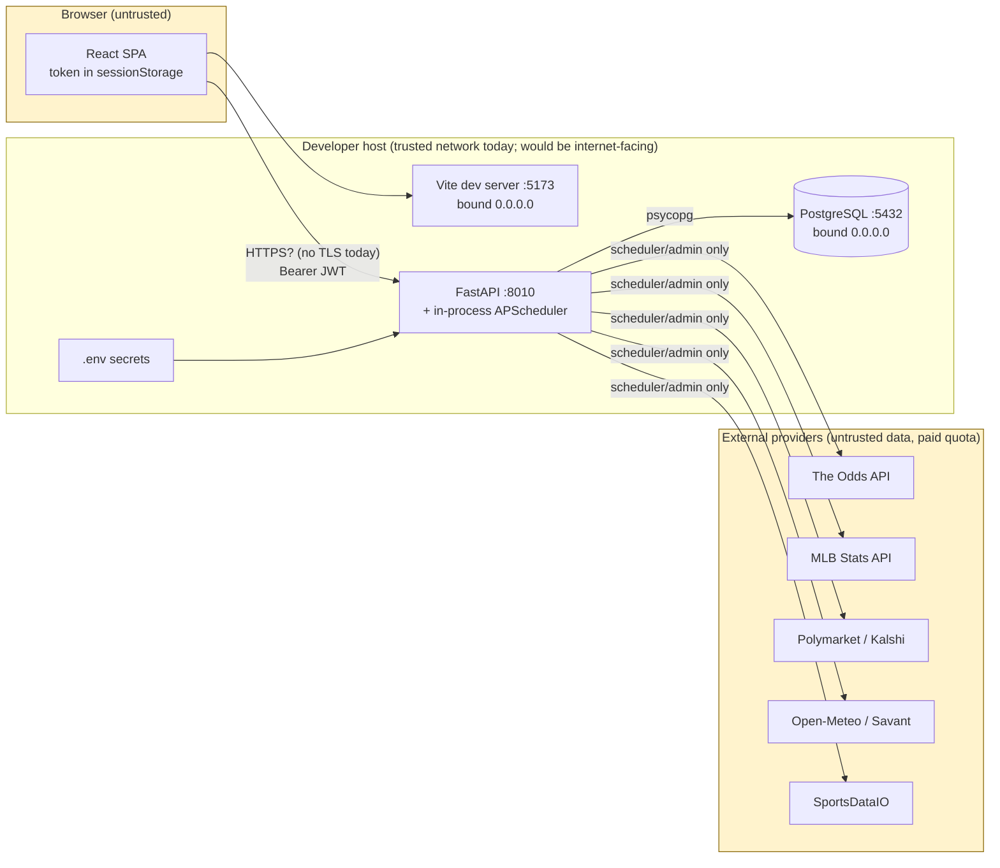

# AISP Threat Model — Fable 5.1 Production-Readiness Audit

Audited commit: `932f5564890b9f411ee6d7f323dea2800a8c2a78` (branch `codex/multisport-platform-architecture`)
Audit branch: `claude/fable51-production-readiness-audit`
Date: 2026-09-03

Evidence labels used throughout: **OBSERVED** (read directly from code/config/runtime), **REPRODUCED** (demonstrated by a test or probe in this audit), **INFERRED** (reasoned from evidence, not directly demonstrated), **NOT TESTED**, **BLOCKED**.

No secret value appears in this document. Where a secret's *existence* matters, only its variable name is cited.

---

## 1. Assets

| Asset | Where it lives | Why it matters |
|---|---|---|
| Immutable virtual ledger: `official_asp_positions`, `position_results`, `shadow_experiment_decisions`, `shadow_experiments` | PostgreSQL `asp` (localhost:5432) | The product's scientific record. Retroactive mutation destroys the experiment's credibility. |
| Forecast history: `forecasts`, `forecast_components`, `market_comparisons`, `game_feature_snapshots` | PostgreSQL | Reproducibility and performance claims depend on it. |
| Market evidence: `odds_snapshots` (append-only), prediction-market snapshots | PostgreSQL | Provenance for every decision; also the largest hot-path table. |
| User credentials: `users.password_hash` (argon2 via `pwdlib`), `token_version` | PostgreSQL | Account takeover surface. |
| Provider credentials: `THE_ODDS_API_KEY`, `SPORTSDATAIO_API_KEY`, `LLM_API_KEY`, `KALSHI_*` | repo-root `.env` (git-ignored), process environment | Denial-of-wallet (paid quota) and reputational exposure. |
| Application secret: `SECRET_KEY` (HS256 JWT signing) | `.env` | Forged tokens ⇒ full admin. |
| Database credential | `DATABASE_URL` in `.env` | Total data compromise. |
| Provider quota (Odds API daily budget) | `provider_request_ledger` + provider | Finite, paid; exhaustion blinds the pipeline. |
| Availability of the daily operational loop | in-process APScheduler | A dead loop yields a silent zero-slate day. |

## 2. Actors

| Actor | Trust | Capability today |
|---|---|---|
| Anonymous public visitor | Untrusted | Every `GET` read endpoint except `/health*`, `/admin/*`; `/auth/register`, `/auth/login`. |
| Registered MEMBER | Low | Same as anonymous plus `/auth/me`, `/auth/logout`. **OBSERVED:** no member-owned resource endpoint exists (bankroll/positions are platform-level, read-only, public). |
| ADMIN | High | Job triggers (provider spend), availability events (rescore path), prediction-market mapping approval, operational health. One admin exists. |
| Scheduler (same process as API) | Privileged | All provider egress, all ledger writes. |
| External providers (MLB Stats API, The Odds API, Open-Meteo, Baseball Savant, Polymarket, Kalshi, SportsDataIO) | Untrusted input | Malformed/hostile payloads; quota; outages. |
| Local machine users / LAN peers | Semi-trusted | **OBSERVED:** Vite dev server binds `0.0.0.0:5173`; PostgreSQL binds `0.0.0.0:5432`. |
| Other agents editing the repo (Codex worktree present) | Semi-trusted | Concurrent edits; not a runtime threat. |

## 3. Trust boundaries

Boundary B1 — Browser ⇄ API: bearer JWT in `Authorization`; CORS allowlist; no cookies (CSRF not applicable). **OBSERVED.**
Boundary B2 — API ⇄ PostgreSQL: single application role `asp_user`; ORM-level immutability guards only. **OBSERVED.**
Boundary B3 — API/scheduler ⇄ providers: fixed host constants, timeouts, quota ledger; egress confined to `app/data_sources`, `app/prediction_markets`, `app/prospective`. **OBSERVED.**
Boundary B4 — Process ⇄ host: `.env` file, `--host 0.0.0.0` listeners. **OBSERVED.**

## 4. Entry points and attack surface

| Surface | Auth | Rate limit | Notes |
|---|---|---|---|
| `POST /api/v1/auth/register` | none | 10/min/IP (in-process) | Open sign-up, no email verification, no breached-password check (flagged in code). |
| `POST /api/v1/auth/login` | none | 10/min/IP | Timing-safe dummy hash; generic error; per-IP only (no per-account lockout). |
| `GET /api/v1/today`, `/dashboard/today`, `/markets/board`, `/games/{id}`, `/performance`, `/bankroll`, `/experiment/*`, `/research/history*`, `/shadow-board*`, `/prediction-markets/*`, `/public/config`, `/sports/registry` | none | **none** | Public reads. DB-only (**REPRODUCED**: httpx monkeypatch tests + audit probes). Expensive: `/today?date=` and `/markets/board?date=` accept **any** date. |
| `POST /api/v1/admin/jobs/{job}` | ADMIN | 60/min/IP | Provider spend path (denial-of-wallet if admin token leaks). |
| `POST /api/v1/admin/availability-events` | ADMIN | 60/min/IP | Triggers rescore. |
| `POST /api/v1/admin/prediction-markets/mappings/approve` | ADMIN | 60/min/IP | Append-only, audited. |
| `GET /health`, `/health/sources` | ADMIN | — | Operational detail. |
| `GET /healthz`, `/readyz` (new) | none | — | Liveness / readiness booleans only. |
| `/docs`, `/openapi.json` | none in dev | — | Disabled when `APP_ENV=production` (**OBSERVED** guard + test). |

## 5. Threats → controls → residual risk

Severity uses the audit's P0–P3 scale. "Control" cites the exact code that implements it.

### 5.1 Authentication and session

| Threat | Control (evidence) | Status | Residual / finding |
|---|---|---|---|
| Credential stuffing / brute force | `rate_limit("auth:login")` 10/min per socket peer (`app/core/rate_limit.py`); argon2 (`PasswordHash.recommended()`) | OBSERVED, tested (`test_login_is_rate_limited`) | In-process counter ⇒ resets on restart, not shared across replicas, keyed by peer IP only (no per-account lockout, no CAPTCHA). **P2** |
| Account enumeration | Dummy-hash verify on unknown email; single generic 401 message | OBSERVED | Register returns 409 on duplicate email ⇒ enumeration via `/auth/register` is possible. **P3** |
| Token forgery | HS256 pinned `algorithms=[ALGORITHM]`; `type=="access"` and `sub` required; tests for `alg=none`, tampered, wrong secret, expired | OBSERVED + tested | Production guard rejects default/short `SECRET_KEY`. Development default secret is a known string — never deploy `APP_ENV != production`. |
| Stolen token replay | 60-min lifetime; `ver` claim bound to `users.token_version`; logout bumps version; status re-checked per request (`get_current_user`) | OBSERVED + tested | No refresh token ⇒ 60-min hard sessions; no per-token denylist (jti unused). Acceptable for beta. |
| XSS ⇒ token theft | Token in `sessionStorage` (tab-scoped); no `dangerouslySetInnerHTML` anywhere (**OBSERVED grep**); nginx CSP `script-src 'self'`; API CSP `default-src 'none'` | OBSERVED | Any future XSS exposes the token; sessionStorage limits blast radius to the tab. CSP `connect-src` allows `https:` wildcard — tighten in production. **P3** |
| Session fixation / CSRF | No cookies ⇒ N/A | OBSERVED | — |
| Disabled user keeps access | `user.status != ACTIVE` ⇒ 401 on every request | OBSERVED | No admin endpoint to disable a user exists yet (DB-only). **P3** |
| Password reset / email verification / MFA | Not implemented | OBSERVED | Required before public launch (recovery, abuse). **P2** |

### 5.2 Authorization and isolation

| Threat | Control | Status | Residual |
|---|---|---|---|
| Member reaches admin route | `require_admin` reads role from the DB row, not the JWT claim (`test_forged_admin_role_claim_does_not_escalate`) | OBSERVED + tested | — |
| IDOR / BOLA on user data | **No user-owned resource endpoints exist.** Per-user tables (`user_virtual_bankrolls`, `community_posts`, `private_leagues`, …) are schema-only with no routes. | OBSERVED | Isolation must be designed *before* those routes ship (object-level checks + tests). Currently **N/A**, not "proven". |
| Client-supplied user id trusted | No endpoint accepts a user id in the body/query for authorization | OBSERVED | — |
| Header trust | `X-Forwarded-For` ignored unless `rate_limit_trust_forwarded_for=true` | OBSERVED | Correct default; must be enabled *only* behind a trusted proxy. |

### 5.3 Ledger integrity

| Threat | Control | Status | Residual |
|---|---|---|---|
| Duplicate position | DB `uq_official_position_experiment_outcome (shadow_experiment_id, market_outcome_id)` + unique `shadow_decision_id`; check-then-insert in `_create_canonical_position` | OBSERVED | Concurrent duplicate ⇒ `IntegrityError` ⇒ job fails and retries; never two rows. |
| Duplicate settlement | `uq_position_result(position_id)`; pre-check in `_settle_experiment` | OBSERVED | Same guarantee. |
| Double debit/credit | Bankroll is **derived** (`starting_bankroll + Σ profit_loss`), never a stored balance | OBSERVED | Structural — no counter to corrupt. |
| Retroactive edit | ORM `before_flush` guards (`app/audit/immutability.py`) for positions, settlements, decisions, experiments, snapshots | OBSERVED + tested | **ORM-only.** Raw SQL / another client / a migration can mutate. One DB trigger exists (label-access) proving the pattern is available. **P2 — add DB triggers/role separation.** |
| Precision | `Numeric(12,2)` for stake/payout/profit; `Float` for odds/probabilities | OBSERVED | Acceptable (odds are inputs, money fields exact). |
| Quote drift | Position binds `odds_snapshot_id`; `_create_canonical_position` verifies snapshot ⇔ decision price/time equality | OBSERVED | — |

### 5.4 Provider / egress

| Threat | Control | Status | Residual |
|---|---|---|---|
| Public read triggers provider call (denial-of-wallet) | Egress confined to ingestion/job modules; `test_public_reads_make_zero_provider_calls`, `test_today_read_makes_no_provider_call`; audit probes | OBSERVED + REPRODUCED | — |
| SSRF / arbitrary URL | All hosts are constants in `config.py`/adapters; no user-supplied URL reaches `httpx` | OBSERVED | — |
| Quota exhaustion | `provider_request_ledger` with reservation/terminal states and check constraints; daily budget; pregame window gating | OBSERVED | Quota state is DB-backed (replica-safe). |
| Malformed provider payloads | `SourceError` ⇒ 503/424; per-source timeouts | OBSERVED | Response-size bound not enforced (**P3**). |
| Trading via Polymarket/Kalshi | Clients are GET-only (**OBSERVED grep**: no `.post(`, no order symbols; `test_no_trading_symbols_in_prediction_market_package`) | OBSERVED + tested | — |
| Admin job trigger abuse | ADMIN + 60/min | OBSERVED | Rate limit in-process only. |

### 5.5 API robustness

| Threat | Control | Status | Residual |
|---|---|---|---|
| SQL injection | SQLAlchemy Core/ORM throughout; no f-string `text()` (**OBSERVED grep**) | OBSERVED | — |
| Command injection | No `shell=True`, `eval`, `exec` (**OBSERVED grep**); NFL producer launched without a shell | OBSERVED | — |
| Path traversal | No user-controlled file paths on routes | OBSERVED | — |
| Unbounded pagination | `/research/history/games` `page_size ≤ 100` | OBSERVED | Other list endpoints return bounded slates by date. |
| Oversized bodies | **No request-size limit middleware** (**OBSERVED grep**) | — | Rely on reverse proxy (`client_max_body_size`). **P3** |
| Expensive reads as DoS | `/today?date=`, `/markets/board?date=`, `/performance` cost 4–9 s CPU each (**REPRODUCED**); no rate limit, no cache | — | **P1 — see scale report.** The query-rewrite repair cuts the worst path ~4×; caching/read-model still required. |
| Stack-trace leakage | FastAPI default 500 body; `SourceError` handler returns message only; docs off in production | OBSERVED | — |
| Regex DoS | No user-input regex | OBSERVED | — |

### 5.6 Secrets and supply chain

| Threat | Control | Status | Residual |
|---|---|---|---|
| Committed secrets | `.env` git-ignored; `git log --all -- .env` empty (**OBSERVED**) | OBSERVED | `SportsDataIO.txt` open in Notepad inside the repo root: not tracked, **not git-ignored** by pattern ⇒ one `git add .` from committing a key. **P2** |
| Secrets in logs | `apiKey` query redaction filter; httpx transport at WARNING | OBSERVED | Kalshi private-key path handling NOT TESTED. |
| Secrets in frontend bundle | Only `VITE_API_URL` is baked | OBSERVED | — |
| Weak defaults | Production validator rejects default secret/admin password/demo/CORS | OBSERVED + tested | Development mode has no such guard; **never** expose a dev-mode process. |
| Python deps | `pip-audit`: 1 advisory — `pytest 8.4.2` PYSEC-2026-1845 (UNIX `/tmp` DoS; dev-only) | REPRODUCED | Not exploitable in production image. No lockfile/hash pinning (**P3**). |
| npm deps | `npm audit`: 1 moderate — `echarts <6.1.0` (fix available) | REPRODUCED | Upgrade in a normal change window. **P3** |
| Container | Runs as root; migrations + `create-admin` at container start; hard-coded local DB password in compose (value redacted; see SEC-DB-001) | OBSERVED | Local-only compose; must not be the production shape. **P2** |
| CI | No `.github` / pipeline exists | OBSERVED | No automated gate on merge. **P2** |

### 5.7 Operational availability

| Threat | Control | Status | Residual |
|---|---|---|---|
| Scheduler dies with the API process | Scheduler embedded in `lifespan` | OBSERVED | Single point of failure; **REPRODUCED** twice this week (process killed ⇒ no jobs). |
| Missed daily pipeline | APScheduler `misfire_grace_time=900` | OBSERVED | **REPRODUCED**: 2026-09-03 had no `daily-pipeline` run ⇒ 0 games / 0 forecasts. **Repaired** (startup catch-up). |
| Orphaned RUNNING jobs | none | OBSERVED | 4 rows RUNNING for days. **Repaired** (startup reconciliation). |
| Silent job failure | Failures logged + `job_runs.status=FAILED` + audit event | OBSERVED | Visible only to an admin reading `/admin/jobs`; no alerting. `evaluate-prediction-market-alerts` failed 286/332 runs unnoticed. **Repaired** (root cause) + alerting still required. |
| Head-of-line blocking | none | **REPRODUCED**: 3 ms endpoint stalled 28–53 s while scheduler jobs ran on the event loop | **P1 — process separation required** (see architecture plan). |
| Duplicate scheduler across replicas | `max_instances=1` (process-local); no DB lease | OBSERVED | Two API replicas ⇒ duplicate provider spend and duplicate work (ledger rows protected by constraints). **Scale-out blocker.** |

## 6. Residual risks accepted for a private beta (explicitly)

1. In-process rate limiting (single instance only).
2. ORM-only immutability (no DB triggers) — acceptable while only the application role writes.
3. No refresh tokens / password reset / MFA — acceptable for an invited cohort with admin-managed accounts.
4. No request-size limit at the app layer — must be provided by the reverse proxy.

## 7. Risks that block public exposure (must be closed first)

1. Any dev-mode listener reachable from the internet (`0.0.0.0` binds, `APP_ENV=development`).
2. Expensive uncached public reads (`/today?date=…`, `/markets/board?date=…`, `/performance`) — trivially abusable as CPU DoS.
3. Embedded scheduler blocking the API event loop.
4. No CI gate; no backup/restore evidence (see master report §15).
5. Open registration without email verification or breached-password screening.
