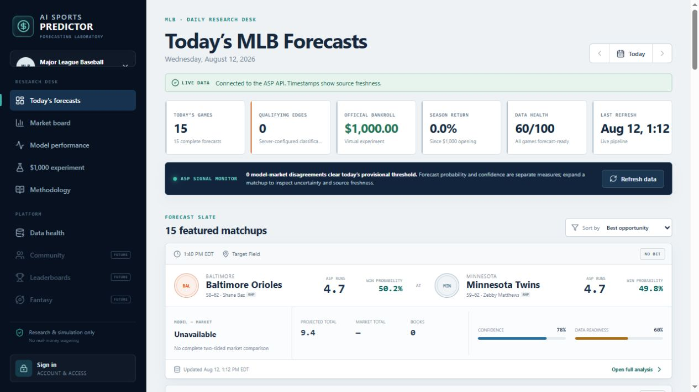
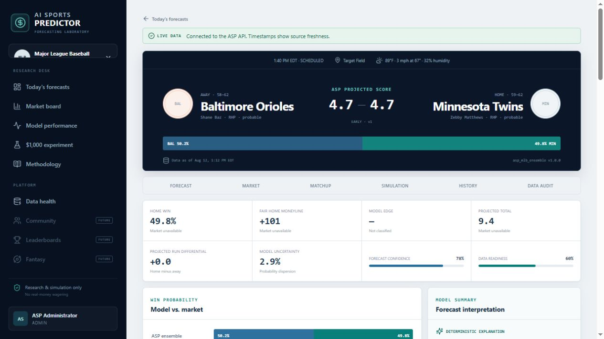
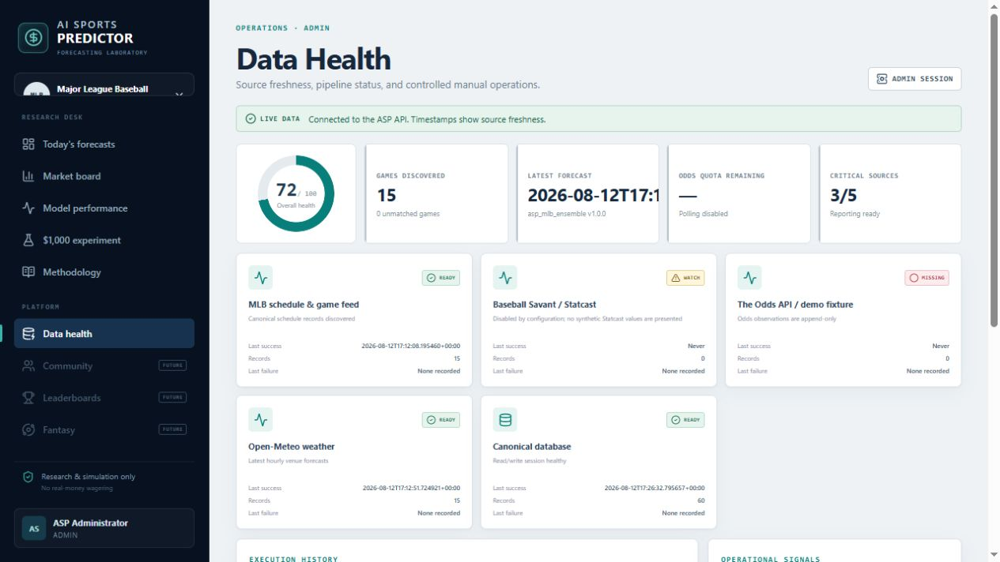
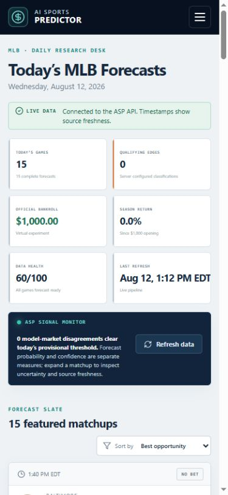

# AI Sports Predictor — Phase 1 Delivery Report

> Historical Phase 1 record. Phase 1.5 supersedes its automatic fixture and
> startup behavior: live API failures now remain unavailable, and illustrative
> frontend data requires explicit `/demo` selection.

Delivered: August 12, 2026

Project root: `C:\Users\james\ai-sports-predictor`

## Key configuration — do this first

The local secret file already exists and is excluded from Git:

`C:\Users\james\ai-sports-predictor\.env`

Paste the Odds API key only after the equals sign on this existing line:

```dotenv
THE_ODDS_API_KEY=your_actual_key_here
```

Keep `C:\Users\james\ai-sports-predictor\.env.example` blank. Do not
place the key in source code, screenshots, logs, commits, issues, or chat.
Scheduled odds polling remains disabled until it is intentionally enabled.

## Outcome

Phase 1 is implemented as an isolated, local-first MLB forecasting application
with a sport-neutral platform core. It ingests current MLB schedule/team context
and ballpark weather, can optionally acquire independent bookmaker observations,
creates versioned quantitative forecasts and deterministic simulations, exposes
market and model audit views, and maintains an explicitly virtual $1,000
experiment. It does not place wagers or connect to sportsbook accounts.

This is a strong first-generation engineering foundation, not a claim of proven
predictive profitability. Where live evidence does not exist—odds, closing
prices, settled evaluations, Statcast features, or trained boosting artifacts—the
application presents unavailable/provisional states instead of synthetic claims.

## Delivered architecture

```text
MLB Stats API          Open-Meteo          The Odds API (optional)
      |                     |                       |
      +-------------- provider adapters -----------+
                            |
                 raw archive + ingestion ledger
                            |
               canonical, time-aware domain model
                            |
             feature snapshots with as-of cutoffs
                            |
       rating + run model + boosting-compatible challenger
                            |
             seeded Monte Carlo + forecast registry
                            |
                market comparison / no-vig math
                            |
                       FastAPI v1
                            |
              React + TypeScript analytical UI
```

The implementation contains 49 canonical ORM tables, two explicit Alembic
migrations, UUID-based internal identities, provider ID mappings, append-only
odds/forecast evidence, job and ingestion ledgers, users/roles/entitlements, and
virtual bankroll/position records. PostgreSQL 16 is the application target;
SQLite is used only for isolated automated and live-pipeline QA.

## Main application surfaces

All eight Phase 1 routes are implemented inside one responsive, accessible shell:

1. Today's MLB Forecasts
2. Game Analysis
3. Market Board
4. Model Performance
5. $1,000 ASP Experiment
6. Methodology
7. Data Health / Admin
8. Login / Account

The UI uses route-level code splitting, explicit live/demo provenance, null-safe
market and evaluation states, keyboard-accessible navigation, mobile navigation,
reduced-motion support, and security-conscious account/session handling.

## Data-source implementation

| Source | Phase 1 behavior | Important fields | Operational status |
|---|---|---|---|
| MLB Stats API | Current schedule, records, venue, status, probable pitchers, player throwing hand, final scores, and team season statistics | Provider IDs, first pitch, home/away identity, records, starter, runs/game, OPS, OBP, SLG, ERA, K/BB rates | Live validation passed |
| Open-Meteo | Hourly venue forecast selected around first pitch | Temperature, humidity, precipitation, pressure, wind speed/direction, weather code | Live validation passed |
| The Odds API | `baseball_mlb`; h2h, spreads, totals; book/outcome/line/price timestamps; quota headers | American/decimal price, implied probability, market, outcome, point, bookmaker, observed time, request quota | Adapter/mocked contracts passed; no live request made |
| Baseball Savant / Statcast | Isolated, archive-oriented acquisition seam | Reserved xwOBA, barrel, hard-hit, exit-velocity and pitching features | Disabled by default; not yet promoted into canonical live features |
| Demo fixtures | Offline/credential-free exploration | Clearly synthetic schedule, odds, forecasts, performance, and bankroll views | Always labeled `DEMO DATA` |

The live QA pipeline on August 12, 2026 produced 90 records: 15 MLB games,
30 team-stat records, 15 weather observations, 15 feature snapshots, and 15
forecasts. It made zero Odds API calls. The first validated matchup included real
MLB probable-pitcher handedness and current Target Field weather.

## Forecasting and analytics

The initial ensemble is deliberately transparent:

- 30% interpretable team-strength baseline, currently using a neutral 1500 prior
  plus home advantage until a persisted rating updater is promoted.
- 45% statistical run-expectation model using observed season team statistics
  and bounded context; missing starter/bullpen/recent inputs stay neutral.
- 25% boosting-compatible challenger. Training and artifact-registry utilities
  exist, while the current live service explicitly uses the untrained
  deterministic development challenger.

The model records expected home/away runs, total, run differential, win
probabilities, fair moneylines, component outputs, uncertainty, drivers,
readiness, confidence inputs, model version, feature version, and data cutoff.
Published refreshes append a new forecast version.

The simulation engine is seeded and reproducible, with 20,000 draws by default.
It exposes win, run-line, total, score, total-run, and run-differential
distributions. Evaluation utilities support Brier score, log loss, calibration,
winner accuracy, and run/total/differential error using chronological boundaries.
Metrics remain unavailable until eligible settled forecasts exist.

Market utilities implement American/decimal conversion, implied probability,
two-sided no-vig normalization, overround, consensus, best available price,
model-market disagreement, and feature-flagged analytical arbitrage detection.
Missing observations are null; current prices are never substituted for missing
historical or closing prices.

## Security and operational controls

- Local `.env` is ignored; `.env.example` contains credential-free placeholders.
- Odds polling defaults to `false`, scheduled interval defaults to 60 minutes,
  manual calls have a five-minute cooldown, and a configurable quota floor stops
  low-credit requests.
- Passwords are Argon2-hashed through `pwdlib`; JWT bearer sessions enforce
  `ADMIN` and `MEMBER` roles.
- Production guards reject the documented development signing secret, demo mode,
  SQLite/non-PostgreSQL databases, and the documented local admin password.
- CORS, CSP, frame, MIME-sniffing, referrer, and permissions-policy headers are
  explicit.
- Manual admin jobs and official virtual-position publication are audited.
- Official positions are disabled by default and capped at 2.5% of virtual
  bankroll when intentionally enabled.

## Verification evidence

| Gate | Result |
|---|---|
| Backend pytest suite | 40 passed |
| Fresh migration runtime | Included in pytest: upgrade a new SQLite database and execute a server-default insert |
| Frontend Vitest suite | 26 passed across 7 files |
| TypeScript + Vite production build | Passed; route chunks emitted |
| JavaScript dependency audit | 0 known vulnerabilities (0 low/moderate/high/critical) |
| Python dependency consistency | `pip check`: no broken requirements |
| Live MLB adapter | 15 current games returned on August 12, 2026 |
| Live MLB team statistics | 30 teams normalized; core offense and pitching fields populated |
| Live Open-Meteo adapter | 15 venue forecasts normalized |
| End-to-end live pipeline | 90 records, 15 features, 15 forecasts, no source warnings for schedule/stats/weather |
| Odds API usage during build/QA | 0 requests; 0 credits consumed by this work |
| Browser QA | All routes, live/demo states, local admin login, data health, responsive layout, and mobile navigation inspected; no console warnings/errors in the final session |

Browser evidence:









Full-page captures are also retained in `docs/screenshots/`.

## Source-controlled deliverable map

| Area | Primary files |
|---|---|
| Bootstrap/config | `README.md`, `.env.example`, `.gitignore`, `docker-compose.yml`, `scripts/setup.ps1`, `scripts/verify.ps1` |
| API/runtime | `server/app/main.py`, `server/app/api/routes.py`, `server/app/core/` |
| Canonical data | `server/app/models/entities.py`, `server/alembic/versions/` |
| Providers/ingestion | `server/app/data_sources/`, `server/app/ingestion/`, `server/app/jobs/` |
| Forecasting | `server/app/features/`, `server/app/forecasting/`, `server/app/services/forecast_service.py` |
| Markets/bankroll | `server/app/markets/`, `server/app/bankroll/`, `server/app/services/read_service.py` |
| Web application | `client/src/App.tsx`, `client/src/pages/`, `client/src/components/`, `client/src/charts/`, `client/src/styles.css` |
| Verification | `server/tests/`, `client/src/**/*.test.*`, `client/src/test/setup.ts` |
| Design/operations docs | `docs/architecture/`, `docs/data_dictionary/`, `docs/METHODOLOGY.md`, `docs/DATA_SOURCES.md`, `docs/ROADMAP.md` |

Local `.env`, virtual environments, dependencies, production bundles, raw data,
databases, logs, and test artifacts are intentionally excluded from source
control. The six QA screenshots are retained as delivery evidence.

## Startup

The recommended PostgreSQL workflow is documented in the project
[`README.md`](../README.md). After placing the key in `.env`:

```powershell
cd C:\Users\james\ai-sports-predictor
docker compose up --build
```

Then open `http://localhost:5173`, sign in as the configured local admin, and use
Data Health / Admin to run the live source pipeline. Odds polling remains off;
use one intentional manual odds refresh first and inspect the returned quota
state before considering scheduled polling.

## Honest limitations and recommended next work

1. Docker was not installed in the build environment. Compose was reviewed
   statically, but PostgreSQL container startup, volume persistence across a real
   restart, and container health checks still require local execution.
2. No live Odds API request was made because the key was intentionally left
   blank. Provider parsing, normalization, quota logic, cooldowns, and persistence
   were tested with recorded/mocked transports; a one-call local smoke test remains.
3. Statcast acquisition is disabled and archive-oriented. Canonical feature
   promotion, source-specific validation, and historical backfill remain Phase 1
   hardening work.
4. The gradient challenger has training/registry utilities but no validated
   production artifact or published out-of-sample performance yet.
5. Performance and bankroll outcomes correctly remain empty until eligible games
   settle and timestamp-matched market evidence exists. Once a sample exists,
   the read service calculates Brier/log loss, calibration, winner accuracy,
   run-differential and total MAE, monthly rolling metrics, confidence buckets,
   component scorecards, and market-relative Brier where a captured home-side
   no-vig probability exists.
6. Provider-schema errors should be wrapped more consistently, and raw transport
   payloads that fail inside early schema parsing are not guaranteed to archive.
7. Login/admin endpoints do not yet have a distributed rate limiter or database
   job lock. The odds job has in-process cooldown/quota controls, but multi-instance
   deployment needs a shared lock and throttling layer.
8. Browser QA is currently manual rather than a committed Playwright CI suite.
9. Docker/PostgreSQL integration, restart persistence, malformed-provider
   fixtures, and multi-instance operational controls are the highest-priority
   hardening gates before shared production deployment.
10. The lazy analytical-chart bundle is approximately 522 kB minified (177 kB
    gzip). It is route-loaded rather than part of the initial shell, but further
    chart-level splitting is a worthwhile performance optimization.

Source storage, display, attribution, and redistribution rights must be reviewed
against the selected MLB, Baseball Savant, Open-Meteo, and Odds API terms before
commercial publication.
